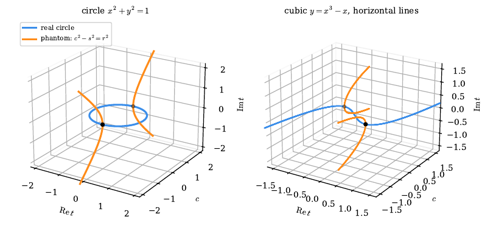
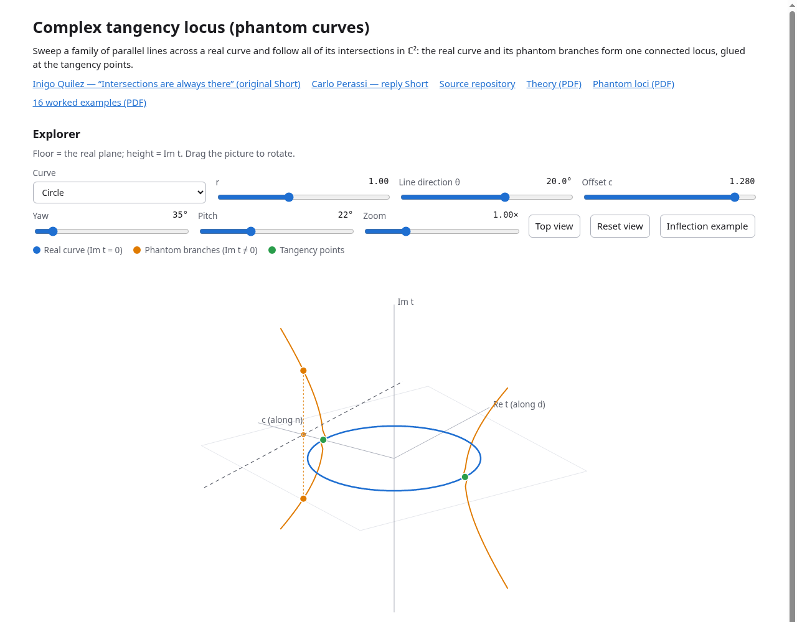

# Hidden intersections

**Closing Quilez's hidden intersections: circles as a complex kei, mirrors, invariants.**
Theory, exercises, storyboards and an interactive explorer.



## The idea in five lines

1. A line that "misses" a circle still meets it, at two complex conjugate points (Inigo Quilez's point).
2. Sweep a family of parallel lines: the real curve and its *phantom* branches form one locus, glued at the tangency points.
3. Treat circles and lines as points of P³(C) with a quadratic form Q; reflecting (inverting) one circle in another is then a linear reflection.
4. Mirroring, C ⋆ L, makes the circles a (complex) kei, and the mirrors generate PO(4,C). A circle meets its mirror image exactly where it meets the mirror (when ⟨C,L⟩ ≠ 0).
5. A single invariant, κ = ⟨C,L⟩²/(Q(C)Q(L)), sorts everything: κ = 1 is tangency, κ = cos²θ for crossing circles, and κ < 0 is possible.

## The two Shorts

- **Original:** Inigo Quilez, *Hidden intersections*: <https://www.youtube.com/shorts/cc-Z_igk4Lo>
- **Reply:** Carlo Perassi, reply Short: <https://youtube.com/shorts/IfTOfr-aFRE>

All credit for the starting question and the construction goes to Inigo Quilez. This repository does not contain any of his video, audio or frames. `video/quilez_transcript.tex` describes his Short in text, with a link to the original.

## Interactive explorer

**<https://carlok.github.io/hidden-intersections/>**: choose a curve (circle, ellipse, parabola, cubic, quartic, lemniscate, Cassini oval) and a line direction, then drag to rotate the complex tangency locus. It is a single static `app/index.html` with no dependencies, so you can also open it locally.



## Repository map

| Path | Contents |
|---|---|
| `theory/` | `theory.tex` (the main paper), `writeup.tex` (phantom loci), `section_inv.tex` (inversive notes), `alt_quandle_note.tex` (kei/quandle note), figures `figs/`, `alt_figs/` and their generators |
| `exercises/` | `examples16.tex`: 16 worked examples (real, complex and mixed), with figures and generators |
| `video/` | storyboards (v4, alt v2, third: `.tex`, `.py`, narration `_script.txt`), a text transcript of Quilez's Short, and the TTS / frame / render scripts |
| `verify/` | every verification script with its log; `check_logs.py` fails if any log reports a failure |
| `app/` | the standalone interactive explorer (`index.html`) |
| `pdf/` | compiled PDFs: theory, writeup, alt note, examples, storyboards, transcript |
| `docs/` | README images |
| `.github/workflows/` | `ci.yml` (verify on every push and PR), `pages.yml` (verify, rebuild PDFs, deploy `app/` + `pdf/` to Pages on push to `main`) |

Main reading order: [`pdf/theory.pdf`](pdf/theory.pdf), then [`pdf/examples16.pdf`](pdf/examples16.pdf), [`pdf/writeup.pdf`](pdf/writeup.pdf) and [`pdf/alt_quandle_note.pdf`](pdf/alt_quandle_note.pdf).

## Build

```sh
python3 -m venv .venv && . .venv/bin/activate
pip install -r requirements.txt
make verify   # all verification scripts (theory_verify.py takes about a minute); logs land in verify/
make pdf      # needs tectonic (https://tectonic-typesetting.github.io)
make site     # assembles _site/ exactly as GitHub Pages serves it
```

Notes:
- The storyboard PDFs in `pdf/` are committed rather than rebuilt: their `.tex` sources include rendered frame dumps (`frames_v4/`, `alt_frames_v2/`, `alt3_frames/`), which are git-ignored. You can regenerate them with the frame scripts in `video/`, but some earlier frame stages and all audio/video renders are not in the repository.
- The narration scripts (`tts_gen.py`, `alt3_tts.py`) need `edge-tts` and network access; the renders need `ffmpeg`.

## Publishing (GitHub Pages)

After the repository is pushed, set **Settings → Pages → Source** to **GitHub Actions**. Every push to `main` then runs the verification, rebuilds the PDFs and publishes the site at <https://carlok.github.io/hidden-intersections/>. The suggested About text and topics are in `repo_meta.json`.

## License

- Code (`*.py`, `app/`, `Makefile`, workflows): [MIT](LICENSE).
- Text, LaTeX sources, figures and PDFs: [CC BY 4.0](LICENSE-docs).
- Inigo Quilez's Short is his own work and is not covered by either license.

Cite this work with [`CITATION.cff`](CITATION.cff).
